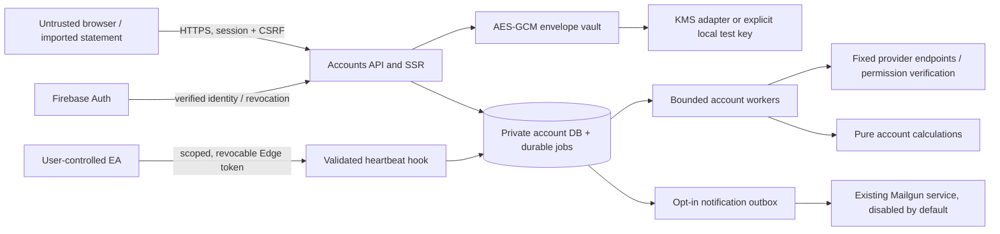

# My Accounts threat model — local implementation, production assumptions pending

Status: repository-grounded draft, 2026-11-03. The user selected **an existing backend they will identify**. The local Node 24.13 / SQLite implementation and injected test adapters are implemented; the production service, database, runtime identity, KMS permissions, secret manager, backups and deployment boundary are not confirmed. This document does not approve production release or third-party credential access.

## System and trust boundaries

The existing FYNX static site and Firebase browser authentication remain in place. Private Accounts HTML is rendered by `backend/accounts/pages.cjs` through `api.loadPage`, from persisted owner-scoped state. Static build artifacts contain a neutral sign-in shell. `backend/accounts/api.cjs` exposes the private HTTP API. `auth.cjs` verifies Firebase identity and issues an opaque service session; `service.cjs` coordinates the SQLite repository, credential vault, durable workers and pure `lib/accounts` engine. Fixed-origin provider adapters live under `providers/`; unsupported providers remain disabled. Edge's user-controlled EA endpoint is a distinct bearer-token trust boundary and passes only validated identity-bound telemetry into Accounts.

Assets include account credentials and envelope keys; authenticated sessions and admin claims; raw statement previews, deals, balances, positions and analysis; provider provisioning identities; deletion receipts; and the integrity of read-only and coverage labels. An attacker may control browser input, an uploaded statement, their own authenticated account, provider response content, a stolen session/EA token, or concurrent requests. Host-root compromise, compromised Firebase/KMS administrators and malicious installed broker software are outside the guarantees of application-level encryption.

| Boundary | Untrusted input | Required control and evidence |
| --- | --- | --- |
| Browser → API | IDs, metadata, credential form, file text | Firebase bootstrap, owner predicates on every record, strict Zod schemas, body/rate limits; `api.cjs`, `schemas.cjs`, repository tests |
| Browser → mutation | Ambient session cookie | Same-origin allow-list plus session-bound CSRF, HttpOnly session, Secure in production, SameSite=Lax; `auth.cjs`, API tests |
| API → storage | SQL values and filesystem location | Parameterized values, fixed table allow-lists, private 0700 directory, 0600 DB/WAL/SHM, foreign keys and transactions; `db.cjs`, foundation tests |
| Storage → worker | Durable job records | Record IDs only, owner/generation/lease checks, bounded attempts and queue, no raw credentials or provider bodies; `jobs.cjs`, `worker.cjs` |
| Worker → provider | Investor/API credential | Positive permission evidence, fixed endpoint/method allow-lists, no arbitrary URL, bounded pagination/retries and shared quota; provider contract tests |
| Vault → KMS | Per-write data key | AES-256-GCM with random DEK/nonce and AAD binding uid/provider/connection; KEK remains outside the DB; `crypto.cjs` tests |
| EA → financial records | Broker-local times and account history | Validated token UID/account hash, IANA timestamp conversion, bounded batches, deduplication, no full-lifetime/continuous-coverage claim; heartbeat integration tests |
| Worker → email | Recipient and observation summary | Current verified Firebase recipient, explicit alert preference, disabled-by-default service flag, fixed Mailgun origin, at-most-once claim; notification test stub |

## Prioritized abuse cases and mitigations

1. **Critical: credential becomes trading authority.** A provider's disabled trading account does not establish investor-only credentials. MT4/MT5 require investor mode and trading disabled together; exchange permissions must positively prove read-only. Unknown permissions refuse the connection. OANDA broad personal tokens and unconfirmed OAuth integrations stay disabled. Prop/funded credentials also require operator-approved firm permission evidence before encryption or queueing. No trading/order/transfer/withdrawal routes exist. Remaining gate: operator-approved provider agreements and real read-only acceptance tests on the identified backend, without paid provisioning until explicitly authorized.

2. **High: one user reads another user's financial data.** Every account, import, job, export, session, assignment and custom rule lookup includes the verified UID. Foreign and unknown IDs use the same 404. Session role comes from the verified Firebase custom claim; admin operations revalidate current claims. Tests exercise Alice/Bob IDs and injection-shaped IDs. Production adapter replacement must retain these predicates, including asynchronous workers and object-storage downloads.

3. **High: XSS or CSRF creates connections or exports records.** Sensitive actions require recent authentication (five-minute `auth_time`, not merely refreshed token), same-origin JSON and session-bound CSRF. Session secrets are HttpOnly and hash-only in storage. Private routes have no-store, no-referrer, frame denial and CSP. The JS-readable `fynx_accounts_present` marker is only a logout/network hint, never authorization. Financial HTML is escaped by root's renderer. Residual: a same-origin script compromise can act as the signed-in user; keep third-party script policy and dependency review in the final production release scope.

4. **High: deleted credentials or trades return after a late worker/provider callback.** Connections are generation-fenced, worker leases identify the current attempt, and user deletion generation is captured across asynchronous credential encryption. Provisioning callback stores a cleanup identity immediately and deletes pending investor input once the remote ID exists. Scoped deletion removes preview jobs and pending alert payloads as well as data tables. Edge private copies use a shared deletion epoch/lock so process-local cache and late refreshes cannot restore older copies. Regressions cover delayed encryption and delayed provisioning callbacks. Cleanup that has not been confirmed remains pending/manual review; no provider deletion is fabricated.

5. **High: account deletion leaves secondary copies.** Account snapshots, positions, deals, trades, caches, staged source/preview records, exports, matching jobs and pending account notifications are deleted. Relevant raw Edge heartbeats and owner-derived Edge snapshot/plan caches are erased under the shared epoch. Minimal deletion receipts, authenticated sessions and remote cleanup tombstones are retained explicitly; the Firebase identity and unrelated billing are preserved. `secure_delete` and a WAL truncate checkpoint are applied locally. **This does not prove SSD forensic erasure or erase backups.** Production backup TTL, restore-time deletion replay, encrypted-volume policy and KMS/backup key retirement require the identified backend owner before a 24-hour production deletion promise.

6. **High: shared cloud account costs are bypassed.** Atomic account creation checks server-owned account and cloud limits. Queued active connections and unresolved MetaApi cleanup reservations consume the limit. Default free cloud limit is one; no client tier is trusted. The optional entitlement resolver must use the existing authoritative subscription backend. Provider request budgets are shared through SQLite, with MT4/MT5 sharing the MetaApi quota/circuit key. Remaining gate: production multi-host shared quotas, spend monitoring, and actual provider plans.

7. **Medium/high: stale numbers look current.** Cards use actual observation timestamps; freshness expires after three minutes. Edge Guard checks the metric observation basis against the newest saved snapshot, rejects disconnected/revoked/stale sources, and never invents broker contract metadata. Rolling analysis loads the newest 100,000 snapshots and discloses the bounded history. Cached chart sampling is display-only; calculations use the worker's full selected observations. Unknown equity, FX, original risk and cashflow completeness remain null. Provider coverage tests are required when adapters change.

8. **Medium: statement or provider data exhausts CPU, memory or disk.** Imports are limited to 5 MB / 100,000 rows, parsed as text without scripts or network execution. Calculation workers use bounded concurrency, memory and wall time. Jobs, retries, exports and provider pagination have explicit caps. API/SSR reads materialized bounded results. Remaining gate: production storage quotas, durable worker supervisor and observability; the local polling loop is not proof of a deployed scheduler.

9. **Medium: credential or financial details leak through diagnostics/export.** Logger fields are allow-listed, sensitive keys are redacted, provider exceptions have fixed messages, and job payloads contain IDs only. Secrets never appear in account responses, URLs controlled by this API, exports, audit payloads or fixture files. CSV protects spreadsheet formula prefixes, including whitespace/control prefixes. Provider-required request signatures are not logged. AES-GCM AAD and tamper tests prevent ciphertext swaps across users/providers/connections. JS runtime strings cannot be reliably zeroed; buffers are cleared where possible, but host/process memory is a separate trust boundary.

10. **Medium: email sends after an opt-out or deletion.** Alert delivery rechecks preference and verified recipient at send time; scoped deletion purges corresponding queued jobs/outbox payloads. Financial threshold alerts are deduplicated. A successful Mailgun HTTP acceptance is labeled accepted, not delivered. Delivery uncertainty is not retried blindly. Transactional deletion receipts have separate delivery status and do not block local erasure. No live emails were sent during this implementation.

## Validation and release gates

The focused backend suite covers sessions/CSRF/admin role, encryption tampering, private file modes, atomic transactions, cross-user access, real HTTP plus worker-thread import/export, quote/permission failure preservation, EA linking/history, scoped and all-data deletion, late callbacks, lease recovery, queue bounds, provider quota reservations and stale guard prevention. Synthetic fixtures and injected provider/mail adapters are explicitly test-only; these are not live broker, paid provider, KMS IAM or delivered-email acceptance receipts.

Before deployment: identify the existing backend and data location; adapt repository/queue/session/vault and Edge deletion epoch guarantees; choose production cookie forwarding (Firebase Hosting forwards only `__session`, so verify the actual host rather than assuming it); verify TLS/proxy/IP logging configuration; establish KMS least privilege and secret injection; enforce backup/deletion retention; configure existing Mailgun only if approved; connect the server-authoritative subscription limit resolver; run real read-only provider acceptance with permitted accounts; and run cross-process deletion/restart tests on that exact host. The Node 24.13 `node:sqlite` API currently emits an experimental warning in local tests.

Primary guidance checked: [Firebase session cookies and recent sign-in](https://firebase.google.com/docs/auth/admin/manage-cookies), [Firebase Hosting cache/cookie behavior](https://firebase.google.com/docs/hosting/manage-cache), [Google Cloud envelope encryption](https://docs.cloud.google.com/kms/docs/envelope-encryption), [Node 24.13 SQLite API](https://nodejs.org/download/release/v24.13.0/docs/api/sqlite.html), [Node authenticated encryption API](https://nodejs.org/api/crypto.html). Provider-specific evidence is in `docs/accounts-providers.md`.
